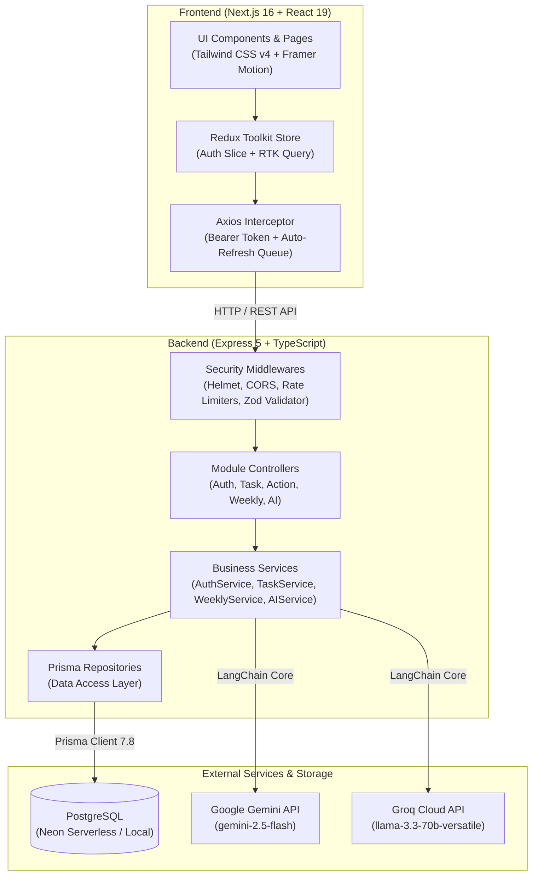

# Task Optimizer

> An intelligent, full-stack task optimization and productivity management ecosystem. Combines daily task tracking, weekly sprint planning, responsive visual analytics, and an AI-powered productivity coach with structured journaling.

---

## 📖 Table of Contents

- [Overview](#-overview)
- [System Architecture](#-system-architecture)
- [Key Features](#-key-features)
  - [Authentication & Session Security](#1-authentication--session-security)
  - [Daily Task & Action Management](#2-daily-task--action-management)
  - [Interactive Weekly Planner](#3-interactive-weekly-planner)
  - [AI Productivity Coach & Journaling ("My Story")](#4-ai-productivity-coach--journaling-my-story)
  - [Productivity Analytics & Visual Performance](#5-productivity-analytics--visual-performance)
  - [User Profile & Security Settings](#6-user-profile--security-settings)
- [Technology Stack](#-technology-stack)
- [Repository Structure](#-repository-structure)
- [Database Schema (Prisma ORM)](#-database-schema-prisma-orm)
- [API Reference](#-api-reference)
  - [Authentication Routes (`/api/v1/auth`)](#authentication-routes-apiv1auth)
  - [Task Routes (`/api/v1/task`)](#task-routes-apiv1task)
  - [Action Routes (`/api/v1/action`)](#action-routes-apiv1action)
  - [Weekly Planner Routes (`/api/v1/weekly`)](#weekly-planner-routes-apiv1weekly)
  - [AI Journal Routes (`/api/v1/ai`)](#ai-journal-routes-apiv1ai)
- [Environment Configuration](#-environment-configuration)
  - [Backend Configuration (`apps/api/.env`)](#backend-configuration-appsapienv)
  - [Frontend Configuration (`apps/web/.env`)](#frontend-configuration-appswebenv)
- [Getting Started & Local Setup](#-getting-started--local-setup)
  - [Prerequisites](#prerequisites)
  - [1. Backend Setup (`apps/api`)](#1-backend-setup-appsapi)
  - [2. Frontend Setup (`apps/web`)](#2-frontend-setup-appsweb)
- [Production Deployment & Scripts](#-production-deployment--scripts)

---

## 🌟 Overview

**Task Optimizer** is an end-to-end web platform designed to streamline daily execution and long-term goal tracking. Built with modern TypeScript across both backend and frontend, it bridges immediate to-do lists, week-level capacity planning, and retrospective AI evaluations.

### Core Strengths

- **Monorepo Architecture**: Clean separation between a layered Express 5 REST API (`apps/api`) and a Next.js 16 App Router client (`apps/web`).
- **Resilient Multi-Provider AI**: Powered by **LangChain** with instant fallback/switch capability between **Google Gemini 2.5 Flash** and **Groq (LLaMA 3.3 70B Versatile)**.
- **Enterprise-Grade Auth**: In-memory Access Tokens, SHA-256 hashed single-use Refresh Tokens in HTTP-Only cookies, timing-attack resistant password validation, and multi-device session revocation.
- **Optimistic UI Updates**: Instant checkbox toggling and status feedback backed by RTK Query cache management and rollback mechanisms.
- **Zero Heavy-Chart Bloat**: Fully custom SVG mathematics with **Framer Motion** for animated productivity curves, donut rings, and task distribution visualizations.

---

## 🏗 System Architecture



---

## ✨ Key Features

### 1. Authentication & Session Security
- **Dual-Token Lifecycle**: Short-lived Access Tokens held in memory; long-lived Refresh Tokens stored in secure, `httpOnly`, `SameSite` cookies.
- **Automatic Token Rotation**: Single-use refresh tokens rotated upon each refresh. Handled client-side via Axios response interceptors that queue pending requests while rotation executes.
- **Database-Level Hash Storage**: Refresh tokens are SHA-256 hashed before saving to PostgreSQL.
- **Anti-Timing Attack Protection**: Password comparison uses dummy bcrypt hashes when users do not exist to maintain constant lookup time.
- **Session Control**: Supports logging out the current device or revoking all active sessions across all devices simultaneously (`/logout-all-devices`).
- **Tiered Rate Limiting**:
  - `authLimiter`: 20 requests / 1 minute (login and auth actions).
  - `apiLimiter`: 300 requests / 1 minute (general API endpoints).

### 2. Daily Task & Action Management
- **Task Scheduling**: Create, edit, toggle, and delete daily tasks with time tracking (`HH:MM` AM/PM picker).
- **Action Categories / Projects**: Group tasks under custom `Action` labels.
- **Referential Integrity**: An Action cannot be deleted while tasks are attached to it (returns HTTP 409 Conflict).
- **Strict Ownership Isolation**: Multi-tenant database queries enforce user ownership. Unowned or non-existent resources return HTTP 404 to prevent resource enumeration.

### 3. Interactive Weekly Planner
- **Week-Start Calendar**: Week views anchored by Monday (`YYYY-MM-DD`), with forward and backward week navigation.
- **Day Distribution**: Organize tasks across `MON`, `TUE`, `WED`, `THU`, `FRI`, `SAT`, and `SUN`.
- **Classification & Weighting**:
  - **Priority Levels**: `HIGH`, `MEDIUM`, `LOW`.
  - **Categories**: `Study`, `Fitness`, `Nutrition`, `Personal`, `Career`, `Other`.
  - **Durations**: Custom durations from 15 to 480 minutes (default: 60 minutes).
- **Real-Time Calculation**: Automatic computation of total, completed, pending, and progress percentage per week.
- **Overdue Detection**: Highlights uncompleted tasks assigned to prior days within the active week.

### 4. AI Productivity Coach & Journaling ("My Story")
- **Timezone-Aware Ingestion**: Reads daily tasks filtered by `APP_TIMEZONE_OFFSET_MINUTES` (defaults to UTC+5:30 / IST).
- **Two-Step Generation Pipeline**:
  1. **Preview Generation (`POST /api/v1/ai/journal`)**: Analyzes completed and pending tasks, generates an executive summary, calculates a productivity score (0–100), and creates an actionable tip for the next day. Returns a preview without altering the database.
  2. **Explicit Save (`POST /api/v1/ai/save`)**: Allows users to review the AI advice before persisting it to their permanent journal log.
- **Duplication Safeguard**: Prevents multiple saved journals for the same day (HTTP 409 Conflict).
- **Strict Response Parsing**: Untrusted LLM output is parsed through dedicated JSON extractors and validated against strict Zod schemas before reaching the client.

### 5. Productivity Analytics & Visual Performance
- **Live Metrics**:
  - Latest Productivity Score & Delta Trend against the previous session.
  - Historical Average Productivity Score.
  - Personal Best Score.
  - Task Completion Ratio and Total Volumes.
- **Custom SVG Charting Engine**:
  - **Productivity Trend Line & Gradient Area**: Dynamic SVG path calculations rendering the last 14 entries.
  - **Task Performance Breakdown**: Visual split of completed vs. pending tasks.
  - **Radial Score Rings**: Animated SVG circular gauges color-coded by achievement tier (Emerald $\ge 75$, Violet $\ge 50$, Crimson $< 50$).

### 6. User Profile & Security Settings
- **Profile Management**: Update full name and contact phone number (validated against international E.164 formats).
- **Account Danger Zone**: Full user account deletion with cascading deletion of all associated tasks, refresh tokens, weekly plans, and journals. Requires explicit `"DELETE"` confirmation.
- **UI Customization Controls**: Configuration switches for Notification alerts, Security preferences, and UI themes.
- **External Roadmap Navigation**: Integrated link out to software engineering and career roadmaps (`https://cracksde.in/roadmap`).

---

## 💻 Technology Stack

### Backend (`apps/api`)

| Category | Technology | Purpose |
| :--- | :--- | :--- |
| **Runtime & Language** | Node.js (ESM), TypeScript 6.0 | Modern JavaScript execution & static typing |
| **Framework** | Express.js 5.2.1 | HTTP routing & controller execution |
| **ORM & Database** | Prisma 7.8, PostgreSQL (Neon) | Relational database modeling, migrations & queries |
| **Database Adapter** | `@prisma/adapter-pg`, `pg` 8.22 | High-performance pooled PostgreSQL client |
| **AI Integration** | LangChain Core 1.2, `@langchain/google`, `@langchain/groq` | Unified LLM abstraction for Gemini & Groq |
| **Validation** | Zod 4.4 | Runtime schema validation for requests and LLM output |
| **Security & Auth** | `jsonwebtoken`, `bcrypt`, `helmet`, `express-rate-limit`, `cookie-parser` | JWT tokens, password hashing, header protection, rate limits |
| **Dev Tooling** | `tsx` 4.22 | Fast TypeScript execution with live reload |

### Frontend (`apps/web`)

| Category | Technology | Purpose |
| :--- | :--- | :--- |
| **Framework** | Next.js 16.2.9 (App Router) | React framework with server rendering & client routes |
| **UI Library** | React 19.2.4 | Modern React components & hooks |
| **State Management** | Redux Toolkit 2.12, React-Redux 9.3 | Global state store, async thunks & slice reducers |
| **Data Fetching** | RTK Query | Cache invalidation, optimistic updates & API hooks |
| **Styling & Design** | Tailwind CSS v4, PostCSS | Utility-first obsidian dark theme styling |
| **Animations** | Framer Motion 12.40 | Modal transitions, layout animations & SVG curves |
| **Forms & Validation** | React Hook Form 7.79, `@hookform/resolvers`, Zod | Type-safe form validation and state |
| **Icons & Feedback** | Lucide React, Sonner 2.0 | Vector iconography and toast notifications |
| **HTTP Client** | Axios 1.17 | Interceptor-managed HTTP communication |

---

## 📁 Repository Structure

```text
Task_Optimizer_Track/
├── apps/
│   ├── api/                           # Backend API service
│   │   ├── prisma/
│   │   │   └── schema.prisma          # Database schema & model definitions
│   │   ├── src/
│   │   │   ├── config/
│   │   │   │   └── env.config.ts      # Validated environment configuration (Zod)
│   │   │   ├── lib/
│   │   │   │   └── prisma.ts          # Singleton Prisma Client instance
│   │   │   ├── middlewares/
│   │   │   │   ├── auth.middleware.ts # Bearer token verification
│   │   │   │   ├── error.middleware.ts# Global error & Prisma code mapper
│   │   │   │   ├── rateLimit.middleware.ts # Auth & general rate limiters
│   │   │   │   └── validate.middleware.ts  # Generic Zod request validator
│   │   │   ├── modules/
│   │   │   │   ├── action/            # Action categories module
│   │   │   │   │   ├── action.controller.ts
│   │   │   │   │   ├── action.repository.ts
│   │   │   │   │   ├── action.routes.ts
│   │   │   │   │   ├── action.schema.ts
│   │   │   │   │   └── action.service.ts
│   │   │   │   ├── ai/                # AI Coach & Journal module
│   │   │   │   │   ├── parsers/       # Resilient JSON output extractors
│   │   │   │   │   ├── prompts/       # Structured AI prompt templates
│   │   │   │   │   ├── providers/     # Gemini & Groq LangChain providers
│   │   │   │   │   ├── ai.controller.ts
│   │   │   │   │   ├── ai.repository.ts
│   │   │   │   │   ├── ai.routes.ts
│   │   │   │   │   ├── ai.schema.ts
│   │   │   │   │   └── ai.service.ts
│   │   │   │   ├── auth/              # Authentication & User module
│   │   │   │   │   ├── auth.controller.ts
│   │   │   │   │   ├── auth.repository.ts
│   │   │   │   │   ├── auth.routes.ts
│   │   │   │   │   ├── auth.schema.ts
│   │   │   │   │   └── auth.service.ts
│   │   │   │   ├── task/              # Daily Tasks module
│   │   │   │   │   ├── task.controller.ts
│   │   │   │   │   ├── task.repository.ts
│   │   │   │   │   ├── task.routes.ts
│   │   │   │   │   ├── task.schema.ts
│   │   │   │   │   └── task.service.ts
│   │   │   │   └── weekly/            # 7-Day Sprint Planner module
│   │   │   │       ├── weekly.controller.ts
│   │   │   │       ├── weekly.repository.ts
│   │   │   │       ├── weekly.routes.ts
│   │   │   │       ├── weekly.schema.ts
│   │   │   │       └── weekly.service.ts
│   │   │   ├── utils/                 # Auth, JWT, Date & Response helpers
│   │   │   ├── app.ts                 # Express application setup
│   │   │   └── server.ts              # HTTP listener & graceful shutdown
│   │   ├── package.json
│   │   ├── prisma.config.ts
│   │   └── tsconfig.json
│   │
│   └── web/                           # Frontend web application
│       ├── src/
│       │   ├── app/                   # Next.js 16 App Router
│       │   │   ├── (auth)/            # Auth routes (/login, /register)
│       │   │   ├── (dashboard)/       # Authenticated dashboard views
│       │   │   │   ├── dashboard/     # Hero overview & recent activity
│       │   │   │   ├── my-task/       # Tasks list & weekly grid
│       │   │   │   ├── progress/      # Analytical charts & trends
│       │   │   │   ├── roadmap/       # Career roadmap redirect
│       │   │   │   ├── settings/      # Preferences & notification settings
│       │   │   │   ├── story/         # AI daily journal history
│       │   │   │   └── profile/       # User profile & account deletion
│       │   │   ├── globals.css        # Tailwind CSS imports & theme rules
│       │   │   ├── layout.tsx         # Root HTML & body structure
│       │   │   └── page.tsx           # Landing redirect / entrypoint
│       │   ├── components/
│       │   │   ├── layout/            # Sidebar, Navbar, DashboardShell
│       │   │   ├── shared/            # AuthGuard, EmptyState, FormField
│       │   │   └── ui/                # Buttons, Inputs, Modals, Spinners
│       │   ├── constants/             # API paths, route links & app names
│       │   ├── features/              # Feature modules (auth, dashboard, progress, schedule, story, tasks, users)
│       │   ├── lib/                   # Axios client & token memory store
│       │   ├── providers/             # Redux & AuthInitializer providers
│       │   └── redux/                 # RTK Store, Slices & Services
│       ├── package.json
│       ├── next.config.ts
│       └── tsconfig.json
└── README.md
```

---

## 🗄 Database Schema (Prisma ORM)

```prisma
datasource db {
  provider = "postgresql"
}

model User {
  id          String   @id @default(uuid())
  name        String
  email       String   @unique
  password    String
  phoneNumber String
  createdAt   DateTime @default(now())
  updatedAt   DateTime @updatedAt

  refreshTokens RefreshToken[]
  actions       Action[]
  tasks         Task[]
  journals      Journal[]
  weeklyPlans   WeeklyPlan[]

  @@index([email])
}

model RefreshToken {
  id        String   @id @default(uuid())
  token     String   @unique // SHA-256 hashed
  userId    String
  expiresAt DateTime

  user User @relation(fields: [userId], references: [id], onDelete: Cascade)

  @@index([userId])
  @@index([expiresAt])
}

model Action {
  id         String   @id @default(uuid())
  userId     String
  actionName String
  createdAt  DateTime @default(now())
  updatedAt  DateTime @updatedAt

  tasks Task[]
  user  User   @relation(fields: [userId], references: [id], onDelete: Cascade)
}

model Task {
  id        String   @id @default(uuid())
  userId    String
  actionId  String?
  title     String
  time      String?
  completed Boolean  @default(false)
  createdAt DateTime @default(now())
  updatedAt DateTime @updatedAt

  user   User    @relation(fields: [userId], references: [id], onDelete: Cascade)
  action Action? @relation(fields: [actionId], references: [id], onDelete: SetNull)

  @@index([userId])
  @@index([actionId])
}

model Journal {
  id                String   @id @default(uuid())
  userId            String
  summary           String
  productivityScore Int?
  completedTasks    Int
  pendingTasks      Int
  createdAt         DateTime @default(now())

  user User @relation(fields: [userId], references: [id], onDelete: Cascade)

  @@index([userId])
}

model WeeklyPlan {
  id        String   @id @default(uuid())
  userId    String
  weekStart String   // Format: YYYY-MM-DD
  createdAt DateTime @default(now())
  updatedAt DateTime @updatedAt

  weeklyTasks WeeklyTask[]
  user        User         @relation(fields: [userId], references: [id], onDelete: Cascade)

  @@unique([userId, weekStart])
  @@index([userId])
}

model WeeklyTask {
  id           String   @id @default(uuid())
  weeklyPlanId String
  title        String
  day          String   // MON | TUE | WED | THU | FRI | SAT | SUN
  priority     String   @default("MEDIUM") // HIGH | MEDIUM | LOW
  category     String   // Study | Fitness | Nutrition | Personal | Career | Other
  duration     Int      @default(60)       // Duration in minutes (15 to 480)
  completed    Boolean  @default(false)
  createdAt    DateTime @default(now())
  updatedAt    DateTime @updatedAt

  weeklyPlan WeeklyPlan @relation(fields: [weeklyPlanId], references: [id], onDelete: Cascade)

  @@index([weeklyPlanId])
  @@index([day])
}
```

---

## 📡 API Reference

All protected endpoints expect a valid JWT passed in the HTTP Authorization header:
`Authorization: Bearer <accessToken>`

### Authentication Routes (`/api/v1/auth`)

| Method | Endpoint | Auth | Description |
| :--- | :--- | :---: | :--- |
| `POST` | `/api/v1/auth/register` | No | Register a new user (`name`, `email`, `password`, `phoneNumber`). |
| `POST` | `/api/v1/auth/login` | No | Authenticate user; returns Access Token and sets HTTP-Only Refresh Token cookie. |
| `GET` | `/api/v1/auth/me` | Yes | Retrieve profile details of the currently logged-in user. |
| `PATCH` | `/api/v1/auth/me` | Yes | Update profile name or phone number. |
| `DELETE` | `/api/v1/auth/me` | Yes | Delete user account and cascade delete all personal records. |
| `POST` | `/api/v1/auth/refresh-token` | Cookie | Rotate expired access token using the HTTP-Only refresh token. |
| `POST` | `/api/v1/auth/logout` | Yes | Invalidate the current refresh token session and clear cookies. |
| `POST` | `/api/v1/auth/logout-all-devices` | Yes | Invalidate all refresh tokens for the authenticated user across all devices. |

### Task Routes (`/api/v1/task`)

| Method | Endpoint | Auth | Description |
| :--- | :--- | :---: | :--- |
| `POST` | `/api/v1/task` | Yes | Create a new task (`title`, optional `time`, optional `actionId`). |
| `GET` | `/api/v1/task` | Yes | Fetch all tasks belonging to the current user. |
| `GET` | `/api/v1/task/:id` | Yes | Fetch a specific task by its UUID. |
| `PATCH` | `/api/v1/task/:id` | Yes | Update task properties (`title`, `time`, `completed`, `actionId`). |
| `PATCH` | `/api/v1/task/:id/toggle` | Yes | Toggle the boolean completion status of a task. |
| `DELETE` | `/api/v1/task/:id` | Yes | Permanently remove a task. |

### Action Routes (`/api/v1/action`)

| Method | Endpoint | Auth | Description |
| :--- | :--- | :---: | :--- |
| `POST` | `/api/v1/action` | Yes | Create an Action category (`actionName`). |
| `GET` | `/api/v1/action` | Yes | List all user Actions with attached task count `_count.tasks`. |
| `GET` | `/api/v1/action/:id` | Yes | Fetch details for a specific Action. |
| `PATCH` | `/api/v1/action/:id` | Yes | Rename an existing Action. |
| `DELETE` | `/api/v1/action/:id` | Yes | Delete an Action (blocked with 409 if active tasks are attached). |

### Weekly Planner Routes (`/api/v1/weekly`)

| Method | Endpoint | Auth | Description |
| :--- | :--- | :---: | :--- |
| `GET` | `/api/v1/weekly?weekStart=YYYY-MM-DD` | Yes | Get or auto-initialize weekly plan, tasks, and completion metrics. |
| `POST` | `/api/v1/weekly/tasks` | Yes | Add task to weekly plan (`weekStart`, `title`, `day`, `priority`, `category`, `duration`). |
| `PATCH` | `/api/v1/weekly/tasks/:id` | Yes | Edit weekly task details. |
| `PATCH` | `/api/v1/weekly/tasks/:id/toggle` | Yes | Toggle weekly task completion state. |
| `DELETE` | `/api/v1/weekly/tasks/:id` | Yes | Remove weekly task from the plan. |

### AI Journal Routes (`/api/v1/ai`)

| Method | Endpoint | Auth | Description |
| :--- | :--- | :---: | :--- |
| `POST` | `/api/v1/ai/journal` | Yes | Analyze today's tasks and return structured AI evaluation (preview only). |
| `POST` | `/api/v1/ai/save` | Yes | Persist the evaluated journal entry for today (prevents duplicates). |
| `GET` | `/api/v1/ai/journals` | Yes | Fetch chronological journal history for analytics and storytelling. |

---

## ⚙️ Environment Configuration

### Backend Configuration (`apps/api/.env`)

Create `apps/api/.env` with the following variables:

```env
# Application Environment
NODE_ENV=development
PORT=4000

# PostgreSQL Connection String (Neon or Local PostgreSQL)
DATABASE_URL="postgresql://<user>:<password>@<host>/<database>?sslmode=require"

# Client Web Application URL for CORS Policy
FRONTEND_URL="http://localhost:3000"

# JWT Authentication Secrets (min 32 characters)
JWT_ACCESS_TOKEN_SECRET="your-super-secret-access-token-key-minimum-32-chars"
JWT_ACCESS_TOKEN_EXPIRY="7d"
JWT_REFRESH_TOKEN_SECRET="your-super-secret-refresh-token-key-minimum-32-chars"
JWT_REFRESH_TOKEN_EXPIRY="30d"

# AI Provider Configuration ('gemini' or 'groq')
AI_PROVIDER=gemini
GEMINI_API_KEY="your-google-gemini-api-key"
GROQ_API_KEY="your-groq-cloud-api-key"

# Timezone Offset in Minutes (Default: 330 for UTC+5:30 / IST)
APP_TIMEZONE_OFFSET_MINUTES=330
```

### Frontend Configuration (`apps/web/.env`)

Create `apps/web/.env` with the following variable:

```env
# URL pointing to the running backend Express API
NEXT_PUBLIC_BACKEND_API_URL=http://localhost:4000
```

---

## 🚀 Getting Started & Local Setup

### Prerequisites

- **Node.js**: `v20.x` or higher
- **Package Manager**: `npm`, `yarn`, `pnpm`, or `bun`
- **Database**: PostgreSQL database (local instance or [Neon Serverless Postgres](https://neon.tech))
- **AI Credentials**: API key from [Google AI Studio](https://aistudio.google.com/) or [Groq Console](https://console.groq.com/)

---

### 1. Backend Setup (`apps/api`)

1. Open your terminal and navigate to the API directory:
   ```bash
   cd apps/api
   ```

2. Install dependencies:
   ```bash
   npm install
   ```

3. Configure environment settings:
   ```bash
   # Create and fill in your environment file
   cp .env.example .env # or create .env directly
   ```

4. Generate Prisma Client and sync database schema:
   ```bash
   npx prisma generate
   npx prisma db push
   ```

5. Launch the backend API development server:
   ```bash
   npm run dev
   ```
   *The server starts on `http://localhost:4000` (or the configured `PORT`).*

6. Verify API health check:
   ```bash
   curl http://localhost:4000/health-check
   # Response: {"success":true,"message":"Api is working fine"}
   ```

---

### 2. Frontend Setup (`apps/web`)

1. Open a second terminal and navigate to the Web directory:
   ```bash
   cd apps/web
   ```

2. Install dependencies:
   ```bash
   npm install
   ```

3. Ensure `.env` is configured:
   ```env
   NEXT_PUBLIC_BACKEND_API_URL=http://localhost:4000
   ```

4. Launch the Next.js development server:
   ```bash
   npm run dev
   ```
   *The web client starts on `http://localhost:3000`.*

5. Open your browser and navigate to `http://localhost:3000`. You can create an account via the Register screen or log in.

---

## 📦 Production Deployment & Scripts

### Backend (`apps/api`)

| Command | Action |
| :--- | :--- |
| `npm run dev` | Starts server in watch mode using `tsx` |
| `npm run build` | Compiles TypeScript into JavaScript (`dist/`) |
| `npm run start` | Runs the compiled production server (`dist/server.js`) |
| `npm run typecheck` | Validates TypeScript types across the codebase |
| `npm run postinstall` | Generates the latest Prisma Client automatically |

> **Production Note for Proxies**: The API incorporates `app.set("trust proxy", 1)` when `NODE_ENV === "production"`, ensuring secure cookie forwarding and correct client IP identification behind reverse proxies and load balancers such as Render, Railway, AWS ALB, or Nginx.

### Frontend (`apps/web`)

| Command | Action |
| :--- | :--- |
| `npm run dev` | Runs Next.js development server with hot module reload |
| `npm run build` | Creates an optimized Next.js production build |
| `npm run start` | Starts the production server |
| `npm run lint` | Runs ESLint 9 checks |
